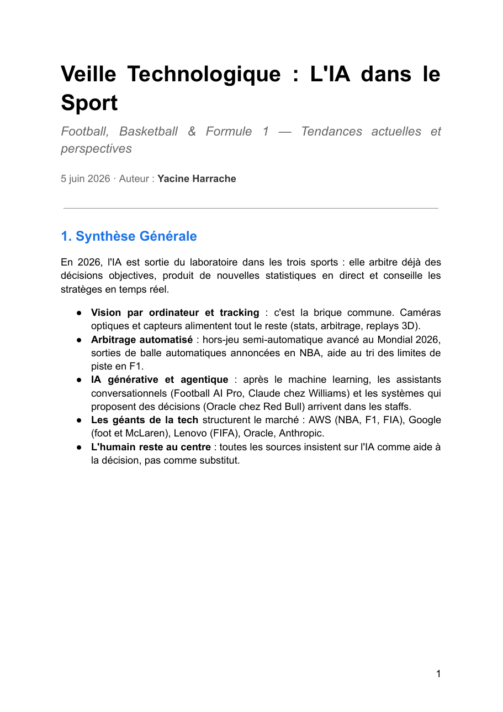

# Veille Technologique — L'IA dans le Sport (Football, Basketball & Formule 1)

> Veille technologique sur l'**intelligence artificielle appliquée au sport**, centrée sur mes trois sports préférés : le **football**, le **basketball (NBA)** et la **Formule 1**. Comment l'IA transforme la performance, la tactique, le recrutement, l'arbitrage et l'expérience des fans — et où se situent ses limites.

---

## 📋 Contexte

Le sport est devenu l'un des terrains d'application les plus visibles de l'IA : vision par ordinateur, tracking des joueurs, modèles prédictifs, IA générative et agentique. J'ai choisi ce sujet parce qu'il croise deux de mes centres d'intérêt, l'informatique et le sport, et qu'il illustre concrètement des technologies que l'on retrouve dans les métiers IT (traitement massif de données, cloud, machine learning, LLM).

**Problématique :** comment l'IA change-t-elle la pratique, l'arbitrage et le spectacle dans le football, le basketball et la F1 ?

---

## 1. Méthode de veille

### Sources de référence

| Sport | Source | Date |
|---|---|---|
| ⚽ Football | [Formations Football — IA foot : comment l'intelligence artificielle transforme le football ?](https://www.formationsfootball.fr/blog/ia-foot) | 7 mai 2026 |
| 🏀 Basketball | [Ultralytics — L'application et l'impact de l'IA dans le basketball et la NBA](https://www.ultralytics.com/fr/blog/application-and-impact-of-ai-in-basketball-and-nba) | 19 mars 2025 |
| 🏎️ Formule 1 | [Motorsport.com — Comment l'IA change-t-elle la Formule 1 ?](https://fr.motorsport.com/f1/news/comment-ia-intelligence-artificielle-changer-f1/10660360/) | 13 janvier 2025 |

### Démarche

1. **Lecture des trois sources de référence** pour poser les grands usages de l'IA dans chaque sport.
2. **Complément par l'actualité récente** (communiqués officiels FIFA et NBA, presse tech et presse spécialisée) pour vérifier que les informations sont toujours d'actualité.
3. **Croisement des sources** : chaque chiffre clé est rattaché à une source datée.
4. **Synthèse comparative** des trois sports et analyse des enjeux.

---

## 2. Synthèse générale

En 2026, l'IA est sortie du laboratoire dans les trois sports : elle **arbitre déjà des décisions objectives**, **produit de nouvelles statistiques en direct** et **conseille les stratèges en temps réel**.

- **Vision par ordinateur et tracking** : c'est la brique commune, qui alimente les stats, l'arbitrage et les replays 3D.
- **Arbitrage automatisé** : hors-jeu semi-automatique avancé au Mondial 2026, sorties de balle automatiques annoncées en NBA, tri des limites de piste en F1.
- **IA générative et agentique** : assistants conversationnels (Football AI Pro, Claude chez Williams) et systèmes qui proposent des décisions (Oracle chez Red Bull).
- **Les géants de la tech structurent le marché** : AWS, Google, Lenovo, Oracle, Anthropic.
- **L'humain reste au centre** : l'IA est une aide à la décision, pas un substitut.

---

## 3. Football ⚽

L'IA est installée dans les staffs (performance, recrutement, santé, tactique) et, depuis la Coupe du monde 2026, au cœur de l'arbitrage.

- **Performance & blessures** : charges d'entraînement ajustées par modèles prédictifs (StatsBomb, Catapult, Hudl), prévention des blessures avec Zone7 (près de 30 % de blessures musculaires en moins selon ses utilisateurs).
- **Recrutement** : Wyscout et SkillCorner évaluent des milliers de joueurs ; le département data science de Liverpool a aidé à repérer Salah et Mané.
- **Coupe du monde 2026** : hors-jeu semi-automatique avancé (alerte directe aux arbitres assistants), joueurs scannés en 3D, 16 caméras par stade et plus de 150 millions de points de données par match.
- **Football AI Pro (FIFA × Lenovo)** : assistant d'IA générative offrant le même niveau d'analyse aux 48 sélections.
- **TacticAI (Google DeepMind)** : prédit les dynamiques de jeu jusqu'à 8 secondes à l'avance, utilisé par Palmeiras depuis juin 2026.

---

## 4. Basketball / NBA 🏀

La NBA est la ligue la plus avancée sur les statistiques et l'arbitrage automatisé.

- **Vision par ordinateur** : détection et suivi du ballon et des joueurs (YOLO11), estimation de pose pour analyser la gestuelle et réduire le risque de blessure.
- **NBA Inside the Game (AWS)** : tracking de 29 points par joueur et trois nouvelles stats IA — *Defensive Box Score*, *Shot Difficulty* et *Gravity*.
- **Play Finder** : recherche instantanée de séquences similaires dans des milliers de matchs.
- **Arbitrage** : Adam Silver a annoncé en mai 2026 que les décisions objectives (sorties de balle) seront confiées à un système IA type Hawk-Eye ; les fautes restent aux arbitres.
- **Entraînement & décision** : robots d'entraînement chez les Warriors, LLM utilisés comme « recruteur supplémentaire » par les 76ers.

---

## 5. Formule 1 🏎️

L'IA est passée du statut de sponsor à celui d'outil opérationnel.

- **Vitesse d'analyse** : chez McLaren, une question qui prenait une demi-journée sur des téraoctets de données se traite en quelques secondes.
- **Fans** : 23 infographies « F1 Insights » (AWS) calculées à partir d'environ 1 million de points de données par voiture et par seconde.
- **Course aux partenariats** : 8 accords écuries–IA en six mois ; 769 M$ de dépenses tech (+41 %) sous un plafond budgétaire de 215 M$.

| Écurie | Partenaire IA | Usage principal |
|---|---|---|
| Red Bull Racing | Oracle | Système agentique qui propose des décisions de stratégie |
| Williams | Anthropic (Claude) | Synthèse des règlements FIA, télémétrie, stratégie |
| McLaren | Google (Gemini) | IA générative appliquée aux opérations |
| Aston Martin | CoreWeave | Calcul intensif : aéro, capteurs, crash-tests virtuels |

- **FIA × AWS (octobre 2026)** : simulation CFD accélérée par IA pour concevoir les règles aéro des voitures de 2030, détection d'anomalies moteur et tri des incidents de limites de piste.

---

## 6. Comparatif des trois sports

| Domaine | Football | Basketball / NBA | Formule 1 |
|---|---|---|---|
| **Collecte de données** | Caméras optiques, GPS, capteurs | Hawk-Eye, 29 points par joueur | Télémétrie (~1M points / s / voiture) |
| **Performance** | Charges d'entraînement | Estimation de pose, robots | Simulation, CFD |
| **Tactique / stratégie** | TacticAI, simulations d'adversaire | Play Finder, LLM | Stratège IA, arrêts au stand |
| **Recrutement** | Wyscout, SkillCorner | Modèles prédictifs, LLM | Très faible |
| **Santé / sécurité** | Prévention des blessures | Analyse biomécanique | Détection d'anomalies |
| **Arbitrage** | Hors-jeu semi-automatique | Sorties de balle automatisées | Tri des limites de piste |
| **Expérience fan** | Chatbots, replays 3D | Stats en direct, clips auto | F1 Insights, second écran |
| **Acteurs tech** | FIFA × Lenovo, Google DeepMind | AWS, Sony Hawk-Eye | Oracle, Anthropic, Google, AWS |

> La **F1** est la plus avancée côté ingénierie, la **NBA** côté stats et arbitrage automatisé, le **football** côté recrutement et démocratisation des outils.

---

## 7. Enjeux et limites

| Enjeu | Constat |
|---|---|
| **Qualité des données** | Un modèle n'est fiable que si ses données sont nombreuses et bien interprétées ; l'imprévu du sport reste difficile à modéliser. |
| **Vie privée des athlètes** | Les données biométriques et médicales posent la question du consentement et de la protection. |
| **Équité entre clubs** | Les gros budgets achètent les meilleurs outils ; Football AI Pro et les outils low-cost (Veo, Playermaker) tentent de rééquilibrer. |
| **Frontière de l'automatisation** | On automatise les décisions objectives, l'humain garde les décisions d'interprétation (contacts, fautes). |
| **Boîtes noires** | Les décisions de l'IA doivent rester explicables pour être acceptées. |
| **Spectacle** | L'intérêt du sport tient à l'humain et à l'incertitude ; trop de prédiction peut nuire au récit. |

**Signaux à suivre :** calendrier de l'arbitrage automatisé en NBA, bilan du hors-jeu avancé après le Mondial, adoption de TacticAI au-delà de Palmeiras, premiers règlements F1 conçus avec l'IA pour 2030.

---

## Ce que cette veille m'a apporté

Cette veille m'a montré que les technologies étudiées en BTS SIO — **traitement de données, cloud, vision par ordinateur, LLM** — sont déjà au cœur d'un secteur grand public comme le sport. J'ai appris à **croiser et dater mes sources**, à distinguer un usage réellement déployé d'une simple annonce, et à garder un regard critique : l'IA aide à décider, mais la décision finale reste humaine.

---

## Documents

- 📄 [Document - Veille Technologique.pdf](Document/Document%20-%20Veille%20Technologique.pdf) — version PDF du dossier complet
- 📝 [Document - Veille Technologique.docx](Document/Document%20-%20Veille%20Technologique.docx) — version Word modifiable

---

## Sources

**Sources de référence**

- [IA foot : comment l'intelligence artificielle transforme le football ?](https://www.formationsfootball.fr/blog/ia-foot) — Formations Football, 7 mai 2026
- [L'application et l'impact de l'IA dans le basketball et la NBA](https://www.ultralytics.com/fr/blog/application-and-impact-of-ai-in-basketball-and-nba) — Ultralytics, 19 mars 2025
- [Comment l'IA change-t-elle la Formule 1 ?](https://fr.motorsport.com/f1/news/comment-ia-intelligence-artificielle-changer-f1/10660360/) — Motorsport.com, 13 janvier 2025

**Actualité complémentaire**

- [Faster offside decisions, more stable referee body cams…](https://inside.fifa.com/innovation/news/offside-decisions-referee-body-cams-innovation-world-cup-2026) — FIFA, 3 juin 2026
- [TacticAI de Google sait prédire le jeu…](https://www.presse-citron.net/foot-tacticai-google-sait-predire-le-jeu-equipe-tester-scenarios-defensifs/) — Presse-citron, 12 juin 2026
- [NBA and AWS announce new multi-year partnership](https://pr.nba.com/nba-aws-partnership/) — NBA, 1er octobre 2025
- [NBA plans AI system for automatic out-of-bounds calls](https://www.artificialintelligence-news.com/news/nba-ai-out-of-bounds-calls/) — AI News, 28 mai 2026
- [La Formule 1 et l'IA : une collaboration qui explose dans les paddocks](https://www.presse-citron.net/formule-1-lia-collaboration-explose-paddocks/) — Presse-citron, 4 mai 2026
- [AI will help design future F1 cars in new FIA/AWS deal](https://www.the-race.com/formula-1/ai-will-help-design-future-f1-cars-in-new-fia-aws-deal/) — The Race, 28 octobre 2026

---

*Réalisé par [Yacine Harrache](https://github.com/yacinehrc) — BTS SIO SLAM | EPSI Lille*
