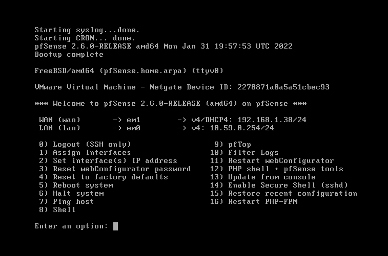
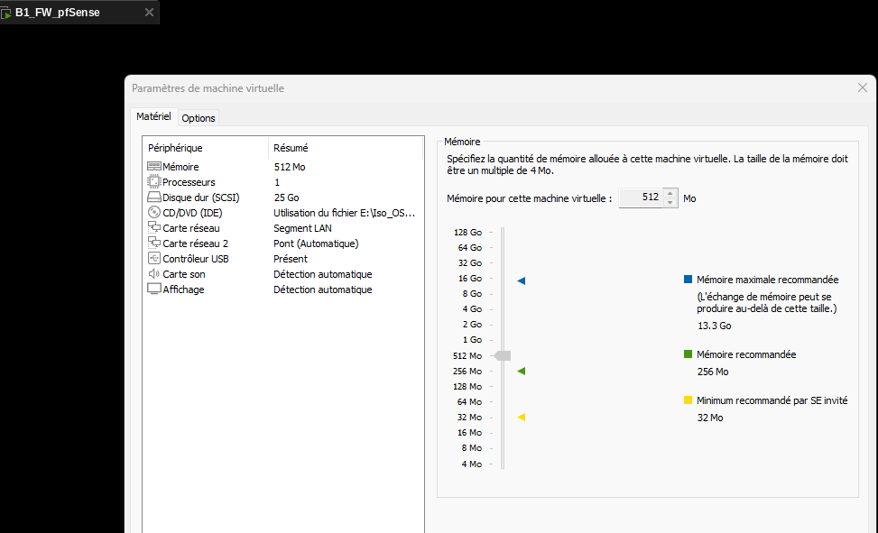
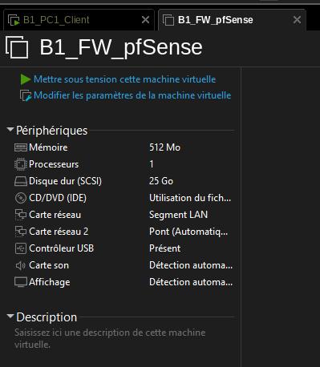
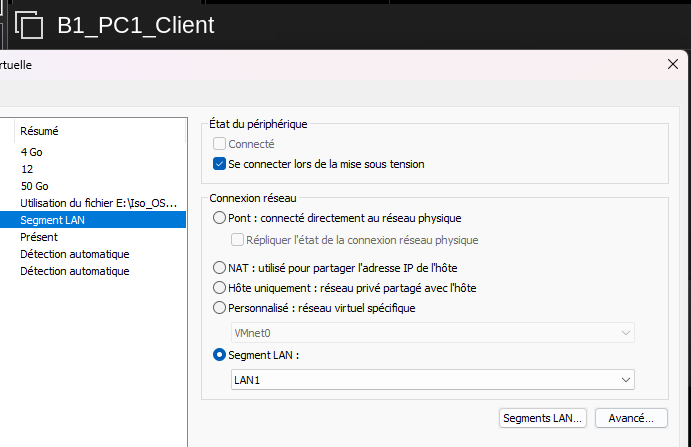
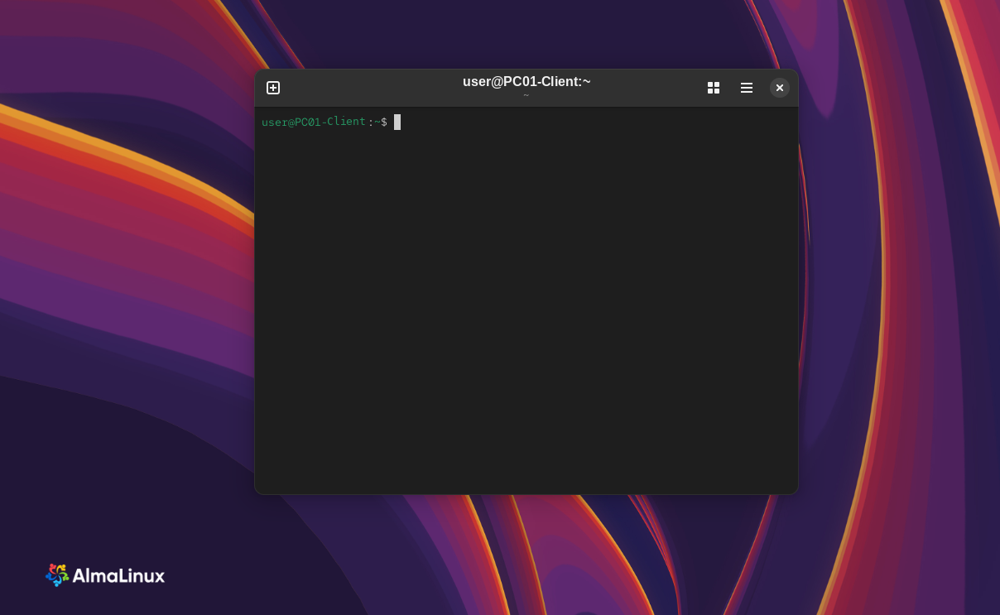
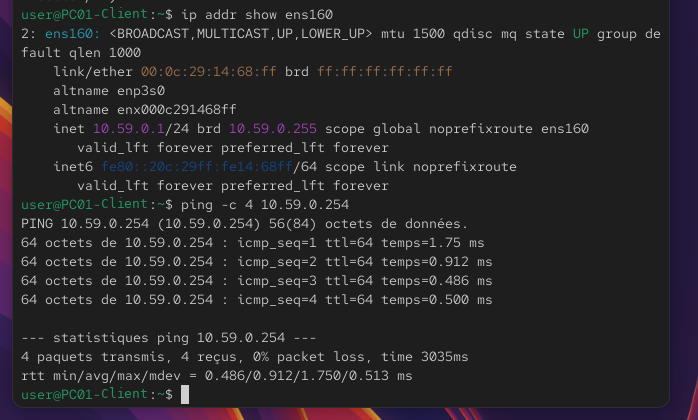
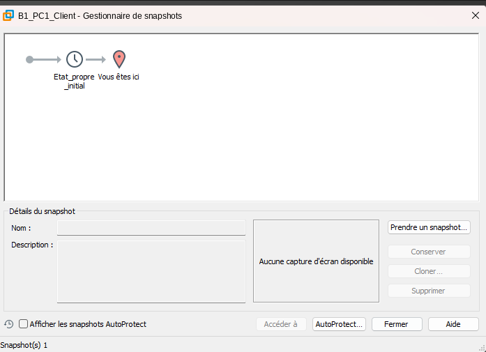
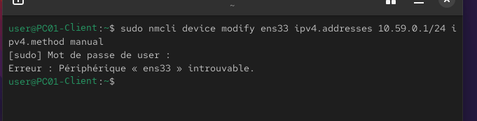
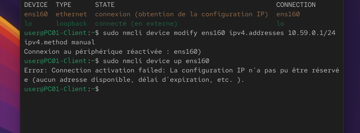
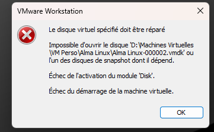

# Virtualisation — Lab virtuel pfSense sous VMware Workstation



> Mise en place d'un **lab réseau virtualisé** sous **VMware Workstation** : un pare-feu/routeur **pfSense CE 2.6.0** et un poste client **AlmaLinux** reliés par un segment LAN isolé, avec adressage IP statique, test de connectivité et gestion des **snapshots**.

---

## Contexte

En tant que technicien support dans une petite entreprise, mon responsable m'a demandé de préparer un **environnement de test virtualisé** afin d'expérimenter de nouveaux logiciels sans impacter les PC physiques de l'entreprise.

La mission : créer, configurer et documenter deux machines virtuelles — un **pare-feu pfSense** et un **poste client** — puis les faire communiquer sur un réseau privé virtuel.

**Objectifs :**

| Objectif | Détail |
|---|---|
| **Comprendre la virtualisation** | Rôle de l'hyperviseur, d'une VM et des snapshots |
| **Créer et dimensionner des VM** | CPU, RAM, disque et cartes réseau adaptés à chaque OS |
| **Routage virtuel** | Relier un client à pfSense via un segment LAN isolé |
| **Sécuriser les manipulations** | Créer un snapshot « état propre » pour pouvoir revenir en arrière |

---

## Prérequis

- **VMware Workstation** installé sur le poste hôte
- Image ISO **pfSense CE 2.6.0** (`pfSense-CE-2.6.0-RELEASE-amd64`)
- Image ISO de l'OS invité (ici **AlmaLinux**)
- Connexion internet active sur l'hôte (pour l'interface WAN de pfSense)

### Ressources

- 📖 [IT-Connect — Créer un lab virtuel pfSense avec VMware Workstation](https://www.it-connect.fr/tuto-vmware-workstation-lab-virtuel-pfsense/)
- 📖 [Documentation officielle pfSense](https://docs.netgate.com/pfsense/en/latest/)

---

## Rappel théorique

| Notion | Définition |
|---|---|
| **Virtualisation** | Technologie qui permet de faire fonctionner plusieurs systèmes d'exploitation sur un seul ordinateur physique en partageant ses ressources. |
| **Machine virtuelle (VM)** | Ordinateur simulé par logiciel, avec son propre OS et ses applications, mais qui utilise le matériel de la machine physique. |
| **VMware Workstation** | Hyperviseur de type 2 qui permet de créer, configurer et exécuter des VM sur un PC (Windows / Linux). |
| **Snapshot** | « Photo » de l'état d'une VM à un instant donné. On en crée avant une manipulation risquée (tests, mises à jour) pour pouvoir revenir en arrière rapidement. |

---

## Architecture du lab

```
                 Internet / réseau physique
                            │
                     (Pont / Bridge)
                            │
               ┌────────────┴────────────┐
               │      B1_FW_pfSense      │
               │   WAN  em1  →  DHCP     │
               │   LAN  em0  →  10.59.0.254/24
               └────────────┬────────────┘
                            │
                 Segment LAN « LAN1 »
                            │
               ┌────────────┴────────────┐
               │      B1_PC1_Client      │
               │  AlmaLinux — PC01-Client│
               │  ens160  →  10.59.0.1/24│
               └─────────────────────────┘
```

---

## Étape 1 — Création de la VM pfSense

### 1.1 — Paramètres de la machine virtuelle



| Élément | Valeur |
|---|---|
| Nom de la VM | `B1_FW_pfSense` |
| Système | pfSense CE 2.6.0 (FreeBSD amd64) |
| vCPU | 1 |
| RAM | 512 Mo |
| Disque | 25 Go (SCSI) |
| Carte réseau 1 | **Segment LAN** `LAN1` → interface LAN |
| Carte réseau 2 | **Pont** (automatique) → interface WAN |



### 1.2 — Installation de pfSense

- Installation à partir de l'ISO `pfSense-CE-2.6.0-RELEASE-amd64`
- Partitionnement : **Auto (UFS) BIOS** — le ZFS n'est pas utilisé
- Connexion internet active pendant l'installation

À la fin de l'installation, la console affiche le menu principal de pfSense avec les deux interfaces détectées (voir capture en haut de page) :

| Interface | Carte | Adressage |
|---|---|---|
| WAN | `em1` | DHCP (réseau physique via le pont) |
| LAN | `em0` | `10.59.0.254/24` |

---

## Étape 2 — Création de la VM cliente (AlmaLinux)

### 2.1 — Configuration de la VM



| Élément | Valeur choisie |
|---|---|
| Nom de la VM | `B1_PC1_Client` |
| Type / version d'OS | AlmaLinux |
| vCPU | 12 |
| RAM | 4 Go |
| Disque virtuel | NVMe 50 Go |
| Mode réseau | **Segment LAN** `LAN1` (même segment que le LAN de pfSense) |

### 2.2 — Installation de l'OS et renommage

- Installation complète d'AlmaLinux jusqu'au bureau
- Configuration minimale : langue, clavier, fuseau horaire, utilisateur
- Renommage du hostname en **`PC01-Client`**

```bash
sudo hostnamectl set-hostname PC01-Client
```



---

## Étape 3 — Configuration réseau

### 3.1 — Côté pfSense

Depuis la console pfSense (option **2 — Set interface(s) IP address**) :

- Interface **LAN** : IP privée de classe A **`10.59.0.254/24`**
- **Sans passerelle** et **sans serveur DHCP** sur l'interface
- Activation du **WebConfigurator** sur cette interface lorsque l'option est proposée

### 3.2 — Côté PC1 (AlmaLinux)

IP fixe **`10.59.0.1/24`**, sans passerelle ni DNS. Sur AlmaLinux, la carte réseau s'appelle **`ens160`** (et non `ens33`) : la configuration se fait sur le profil de connexion NetworkManager.

```bash
# Identifier le nom de l'interface
nmcli device

# Appliquer l'IP statique sur le profil de connexion
sudo nmcli connection modify ens160 ipv4.addresses 10.59.0.1/24 ipv4.method manual
sudo nmcli connection up ens160
```

### 3.3 — Test de connectivité

```bash
ip addr show ens160
ping -c 4 10.59.0.254
```



✅ **4 paquets transmis, 4 reçus, 0 % de perte** — le poste client communique bien avec l'interface LAN de pfSense.

---

## Étape 4 — Snapshot

Création d'un snapshot de la VM dans un état « propre » (OS installé et réseau fonctionnel), nommé **`Etat_propre_initial`**.



> **Pourquoi ?** En cas de mauvaise manipulation (configuration réseau cassée, mise à jour qui échoue…), il suffit de revenir à ce snapshot pour retrouver un environnement fonctionnel en quelques secondes.

---

## Difficultés rencontrées

### Nom de l'interface réseau

La première commande visait l'interface `ens33` (nom courant dans les tutoriels), qui n'existe pas sur cette VM :



**Solution :** lister les interfaces avec `nmcli device` pour trouver le vrai nom (`ens160`).

### Activation de la connexion impossible

Après un `nmcli device modify` sur `ens160`, l'activation de la connexion échouait : le profil restait en **DHCP**, alors qu'aucun serveur DHCP n'est actif sur le segment LAN.



**Solution :** appliquer l'adresse statique et `ipv4.method manual` sur le **profil de connexion** (`nmcli connection modify`) puis réactiver la connexion.

### Disque virtuel à réparer

Au redémarrage de la VM cliente, VMware a refusé d'ouvrir l'un des disques de snapshot (`.vmdk`) :



> Ce type d'erreur survient généralement après un arrêt brutal de la VM ou de l'hôte. Elle rappelle l'importance de toujours **éteindre proprement les VM** et de **conserver des snapshots** d'un état stable.

---

## Tableau de validation

| Test | Résultat attendu |
|---|---|
| VM pfSense démarrée, menu console accessible | ✅ pfSense 2.6.0 opérationnel |
| Interfaces WAN / LAN assignées | ✅ WAN en DHCP, LAN en `10.59.0.254/24` |
| VM cliente installée et renommée | ✅ Hostname `PC01-Client` |
| IP statique sur le client | ✅ `10.59.0.1/24` sur `ens160` |
| Ping PC1 → pfSense | ✅ 4/4 paquets reçus, 0 % de perte |
| Snapshot créé | ✅ `Etat_propre_initial` |

---

## Ce que ce projet m'a apporté

Ce TP m'a permis de comprendre concrètement comment construire un **réseau isolé entièrement virtuel** : un hyperviseur, un pare-feu qui fait le lien entre le réseau physique et un LAN privé, et un poste client qui n'a accès qu'à ce LAN.

J'ai surtout appris à **diagnostiquer** plutôt qu'à suivre un tutoriel à la lettre : vérifier le vrai nom d'une interface, comprendre la différence entre configurer un périphérique et un profil de connexion avec NetworkManager, et savoir lire une erreur de disque virtuel. Les snapshots ne sont plus une option pour moi mais un réflexe avant toute manipulation.

---

## Document

📄 [Document - Lab virtuel pfSense.pdf](Document/Document%20-%20Lab%20virtuel%20pfSense.pdf) — compte-rendu complet du TP avec les captures d'écran.

---

*Réalisé par [Yacine Harrache](https://github.com/yacinehrc) — BTS SIO SLAM | EPSI Lille*
